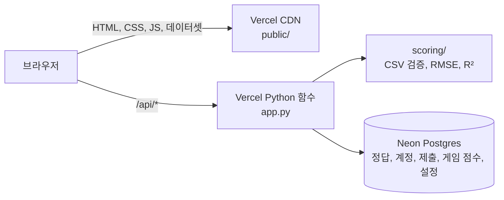

# IBA Scoring Machine

부산대 데이터분석 동아리 IBA의 중고차 가격 예측 회귀 프로젝트를 자동으로 채점하는 사이트다. 팀이 예측 결과 CSV를 올리면 RMSE와 R²를 바로 계산해 리더보드에 올린다. Vercel Hobby와 Neon Postgres Free 무료 티어로 운영해서 비용이 들지 않는다.

- 사이트: https://iba-scoring-machine.vercel.app
- 참가자용 사용법: 사이트의 사용법 페이지(`/how-to-use.html`)

## 읽는 순서

| 읽는 사람 | 먼저 볼 곳 |
|---|---|
| 대회에 참가하는 팀원 | 사이트의 사용법 페이지, 이 문서의 채점 규칙 |
| 이번 기수 대회를 여는 운영진 | 기수 운영, 문제 해결 |
| 사이트를 고치는 사람 | 기술 스택, 폴더 구조, 로컬 실행, 작업 방식, 자주 고치는 곳 |
| 사이트를 처음부터 다시 세우는 사람 | 새로 배포하기 |

## 주요 기능

- 예측 CSV를 올리면 형식을 검사하고 몇 초 안에 RMSE와 R²를 보여 준다. 형식이 틀리면 헤더, 행 수, id 순서 중 무엇이 틀렸는지 알려 준다.
- 리더보드는 로그인 없이 볼 수 있다. 대회 중에는 public 점수를 보여 주고 마감 뒤에는 전체 데이터 기준 최종 순위로 바뀐다.
- 팀당 하루 제출 횟수를 제한하고, 제출 페이지에 오늘 남은 횟수와 다 썼을 때의 초기화 시각을 보여 준다.
- 관리자 페이지에서 대회 일정, 제출, 사용자, 기수 초기화를 코드 수정 없이 관리한다.
- 쉬는 시간용 미니게임 다섯 개와 게임별 개인 순위가 있다. 게임은 사과게임, 테트리스, 블록깨기, 슈팅게임, 스네이크다.
- 사이트를 소개할 때 쓰는 구경용 계정 `iba_dev`가 있다. 이 계정으로 낸 제출과 게임 점수는 기록하지 않고, 리더보드와 게임 순위에는 실제 기록 대신 목데이터가 보인다.

## 채점 규칙

- 제출 파일은 sample_submission.csv와 같은 `id,price` CSV다. 39,085행 전부를 test.csv와 같은 순서로 내야 한다.
- 채점은 id가 아니라 행 위치끼리 짝지어 한다. test.csv, sample_submission.csv, 정답의 id는 0부터 39,084까지의 행 번호다. 원본 데이터의 id는 서로 다른 차량이 같은 값을 쓰는 경우가 많아서 행 번호로 다시 매겼다.
- 순위는 RMSE로 매기고 R²는 참고용이다. RMSE가 같으면 R²가 높은 팀이, 그것도 같으면 먼저 제출한 팀이 위에 온다. 음수 예측은 0으로 바꿔 채점한다.
- 팀당 하루 3회까지 제출할 수 있고 한국 시간 자정에 초기화된다. 횟수는 관리자 페이지에서 바꿀 수 있다.
- 대회 중에는 test의 30%로 계산한 public 점수만 보인다. 마지막 날 다음 날 0시부터 제출이 막히고 리더보드가 전체 데이터 기준 최종 순위로 바뀐다. 최종 순위에는 팀마다 public 점수가 가장 좋았던 제출 1건이 쓰인다. 마감 뒤에도 대회 중 public 순위로 바꿔 볼 수 있다.
- 참가자는 아이디, 비밀번호, 닉네임, 팀 번호로 가입한다. 팀 번호는 이번 기수 팀인 1-4만 받고, 같은 팀 번호를 적은 사람끼리 한 팀이 된다. 리더보드에는 제출하지 않은 팀도 항상 보인다.

public 점수와 최종 점수를 나누는 것은 과적합을 막기 위해서다. 보이는 점수만 보고 모델을 고르면 그 30% 구간에만 잘 맞는 모델이 나오기 쉬워서, 최종 순위에는 대회 중에 본 적 없는 행을 섞는다. Kaggle의 public과 private 리더보드와 같은 방식이다.

## 기술 스택

| 역할 | 도구 | 고른 이유 |
|---|---|---|
| 백엔드 | Python 3.12, FastAPI | 동아리원 대부분이 Python을 쓰고, 채점 로직을 pandas 없이 표준 라이브러리로 짤 수 있다 |
| 프론트엔드 | HTML, CSS, 바닐라 JavaScript | 빌드 단계가 없어서 파일을 고치면 그대로 반영된다 |
| 배포 | Vercel Hobby | `main`에 push하면 자동 배포되고, Python 함수와 정적 파일을 한 저장소에서 같이 올린다 |
| DB | Neon Postgres Free | 신용카드 없이 쓸 수 있는 무료 Postgres다 |

플랫폼을 고른 과정과 무료 티어 한도는 `docs/research/scoring-site-tech-stack.md`에 있다.



페이지와 데이터셋은 Vercel CDN이 `public/`에서 그대로 내려보내고, `/api/`로 시작하는 요청만 Python 함수가 처리한다. 정답은 Neon DB에만 있어서 브라우저에서는 정답을 받을 수 없고, 채점할 때 함수만 정답을 읽는다.

## 폴더 구조

```
app.py               # FastAPI 앱, /api/* 엔드포인트 (Vercel Python 런타임 진입점)
auth.py              # 비밀번호 해시(PBKDF2), 서명 쿠키 세션
store.py             # 저장소 계층: PostgresStore(Neon) / MemoryStore(테스트, 로컬)
scoring/             # 채점 로직
  parse.py           #   제출 CSV 검증
  metrics.py         #   RMSE, R²
  split.py           #   public 구간 선택 (30%)
  teams.py           #   팀 번호와 닉네임 정규화, 이번 기수 팀 목록
  clock.py           #   한국 시간 기준 일정과 제출 횟수 초기화 시각
public/              # 정적 사이트 (Vercel CDN이 그대로 서빙)
  *.html             #   홈, 채점, 리더보드, 사용법, 미니게임, 로그인, 관리자, About, Thanks
  assets/            #   페이지별 CSS, JS, 이미지
  games/             #   미니게임
  data/              #   참가자 배포용 CSV 네 개, baseline 노트북, 이 다섯 개를 묶은 dataset.zip
scripts/             # schema.sql, load_answers.py(정답 적재), grant_admin.py(첫 관리자 지정)
tests/               # pytest (API 레벨)
scoring_machine/     # 참고 노트북 (베이스라인, 3조 코드)
docs/                # 구현 스펙, 결정 기록, 기술 스택 조사
.github/workflows/   # push와 PR마다 pytest를 돌리는 GitHub Actions
vercel.json          # 배포 지역(싱가포르)과 함수 번들에서 뺄 폴더
```

## 로컬 실행

Python 패키지 관리는 uv를 쓴다. uv가 없으면 https://docs.astral.sh/uv/ 에서 먼저 설치한다.

```bash
uv venv --python 3.12 .venv
source .venv/bin/activate          # Windows PowerShell: .venv\Scripts\Activate.ps1
uv pip install -r requirements-dev.txt
```

DB 없이 돌리려면 정답 CSV 경로만 넘긴다. 제출 기록은 메모리에만 남고 재시작하면 사라진다.

```bash
# macOS, Linux
DEV_ANSWER_CSV=answer.csv SESSION_SECRET=dev uvicorn app:app --port 8765

# Windows PowerShell
$env:DEV_ANSWER_CSV="answer.csv"; $env:SESSION_SECRET="dev"; uvicorn app:app --port 8765
```

브라우저에서 http://localhost:8765 를 연다. 이 모드에서는 아무 아이디와 비밀번호로나 로그인되고, 아이디 `admin`으로 로그인하면 관리자 계정이 된다. 실제 배포에서는 이 기능이 꺼져 있다.

정답 파일 없이 화면만 보고 싶으면 `public/`을 8791 포트로 띄운다. 이 포트에서는 `public/assets/local-preview.js`가 API 응답을 흉내 내서 로그인과 리더보드 화면을 볼 수 있다.

```bash
python -m http.server 8791 -d public
```

## 테스트

```bash
pytest
```

실제 정답 파일로 기준값 테스트까지 하려면 `ANSWER_CSV`에 정답 경로를 넣고 `pytest tests/test_real_data.py`를 실행한다. sample_submission을 그대로 내면 전체 데이터 RMSE가 13,189.79로 나와야 한다. 채점 로직을 고쳤다면 push하기 전에 이 테스트까지 돌린다.

GitHub Actions도 `main`에 push하거나 PR을 올릴 때마다 `pytest`를 돌린다. 저장소에는 정답 파일이 없어서 Actions에서는 실제 정답 테스트를 건너뛰고 합성 정답으로 만든 테스트만 실행한다.

## 작업 방식

1. `main`에서 `feat/`나 `fix/`로 시작하는 브랜치를 만든다. 예를 들면 `feat/minigame-screen`, `fix/menu-hover-size`다.
2. 커밋 메시지는 무엇을 바꿨는지 영어 명령형 한 줄로 쓴다. 예를 들면 `Show today's remaining submissions on the submit page`다.
3. push하기 전에 `pytest`를 돌리고, 채점 로직을 고쳤다면 실제 정답 테스트까지 돌린다.
4. GitHub에 PR을 올린다. Vercel이 PR마다 미리보기 주소를 만들어 주므로 화면을 바꿨다면 그 주소에서 확인한다.
5. Actions의 테스트가 통과하면 `main`에 병합한다. 병합하면 바로 실제 사이트에 배포된다.

미리보기 주소도 실제 사이트와 같은 DB를 쓴다. 미리보기에서 가입하거나 제출하면 실제 기록에 남으므로 화면 확인은 구경용 계정 `iba_dev`로 한다.

## 배포

Vercel 팀 pnu-iba와 Neon DB는 동아리 공용 구글 계정으로 관리하고, Vercel은 GitHub 조직의 동아리 계정 pnuiba와 연결되어 있다. 계정 정보는 운영진끼리 따로 전달한다.

`main` 브랜치에 push하면 Vercel이 자동으로 배포한다. 다른 브랜치에 push하면 미리보기 주소가 따로 만들어지는데, 미리보기도 같은 DB를 쓰므로 거기서 낸 제출은 실제 기록에 남는다.

CSS나 JS를 고쳤는데 브라우저에 반영되지 않으면 HTML에서 그 파일을 부르는 주소의 `?v=` 값을 바꾼다. 예를 들어 `about.js?v=cd-flip-2`를 `about.js?v=cd-flip-3`으로 바꾸면 된다.

### 새로 배포하기

계정을 옮기거나 사이트를 처음부터 다시 세울 때만 필요한 절차다.

1. Vercel에서 이 저장소를 가져와 프로젝트를 만든다.
2. 프로젝트의 Storage에서 Neon을 만들어 붙인다. 지역은 함수와 같은 싱가포르로 고르고, 환경변수 접두어를 `DATABASE`로 정하면 코드가 읽는 `DATABASE_URL`이 자동으로 들어간다.
3. 프로젝트 설정의 Environment Variables에 `SESSION_SECRET`을 넣는다. 길고 무작위인 문자열이면 되고, 바꾸면 모든 사용자가 로그아웃된다.
4. Neon 콘솔에서 연결 문자열을 받아 `psql "$DATABASE_URL" -f scripts/schema.sql`로 스키마를 만든다. 이미 만든 DB에 다시 실행해도 빠진 컬럼과 테이블만 추가한다.
5. `DATABASE_URL=... python scripts/load_answers.py answer.csv`로 정답을 처음 한 번만 적재한다. 이때 public 구간이 무작위로 정해지므로, 다시 적재하면 구간이 바뀌어 기존 점수와 맞지 않는다.
6. Vercel에서 최근 배포를 Redeploy해서 환경변수를 반영한다.
7. 운영진 계정을 사이트에서 가입한 뒤 `DATABASE_URL=... python scripts/grant_admin.py <아이디>`로 첫 관리자를 지정한다. 가입할 때는 1-4 중 하나를 팀 번호로 적어야 하므로, 지정한 뒤 관리자 페이지 사용자 탭에서 팀 번호를 0으로 바꾼다.
8. `/api/health`가 `{"ok": true}`를 돌려주는지, 브라우저에서 `/answer.csv`를 열었을 때 파일이 내려받아지지 않는지 확인한다.

## 기수 운영

관리자 계정으로 로그인하면 사이드바에 Admin 메뉴(`/admin.html`)가 보인다. 관리자 계정으로는 제출할 수 없고, 파일 점수만 확인할 때는 채점 확인 기능을 쓴다.

| 탭 | 하는 일 |
|---|---|
| 현황 | 대회 상태, 시작과 마감 시각, 정답 적재 여부, 제출 수와 가입자 수 |
| 대회 설정 | 시작일, 마지막 날, 하루 제출 횟수. 저장하면 바로 반영된다 |
| 제출 | 전체 제출 목록, 삭제와 복구 |
| 사용자 | 팀 번호 변경, 임시 비밀번호 발급, 관리자 지정과 해제 |
| 채점 확인과 초기화 | 기록이 남지 않는 채점, 결과 zip 내려받기, 기수 초기화 |

대회가 끝나면 이번 운영진이 아래 순서로 정리한다.

1. 채점 확인과 초기화 탭에서 결과 zip을 내려받아 운영진끼리 보관한다. 팀별 점수가 들어 있으므로 저장소에는 올리지 않는다.
2. 이번 대회에 쓴 코드에 태그를 붙인다. 이름은 대회를 연 연도와 학기로 짓고, 2026년 2학기라면 `git tag 2026-2` 다음에 `git push origin 2026-2`를 실행한다.

기수 초기화는 이때 하지 않는다. 초기화하면 제출 기록이 지워져서 최종 리더보드도 사라지므로 다음 대회를 열 때까지 그대로 둔다.

다음 대회를 열 때는 새 운영진이 아래 순서로 준비한다.

1. 채점 확인과 초기화 탭에서 기수 초기화를 실행한다. 확인 문구로 `기수 초기화`를 입력해야 실행된다.
2. 새 운영진이 사이트에 가입하고, 기존 관리자가 사용자 탭에서 관리자로 지정한다. 초기화하면 관리자가 아닌 계정이 지워지므로 가입은 초기화한 뒤에 한다.
3. 대회 설정 탭에서 시작일과 마지막 날을 정한다.
4. 팀 수가 4개가 아니면 `scoring/teams.py`의 `TEAMS`를 고쳐 push한다.

초기화하면 제출 기록, 관리자가 아닌 계정, 미니게임 점수가 지워지고 정답과 대회 설정은 남는다. 데이터셋과 정답은 기수가 바뀌어도 그대로 쓴다.

## 자주 고치는 곳

| 하고 싶은 일 | 고칠 곳 |
|---|---|
| 대회 일정, 하루 제출 횟수 변경 | 관리자 페이지 대회 설정 탭 (코드 수정 없음) |
| 팀 수 변경 | `scoring/teams.py`의 `TEAMS` |
| public 구간 비율 변경 | `scoring/split.py`의 `PUBLIC_FRACTION`, 바꾼 뒤 정답을 다시 적재해야 한다 |
| 제출 형식 검사 규칙 변경 | `scoring/parse.py` |
| 페이지 문구와 디자인 변경 | `public/*.html`, `public/assets/` |
| 참가자에게 주는 데이터 교체 | `public/data/`, 정답이 바뀌면 `answers` 테이블도 다시 적재한다 |
| 미니게임 추가와 수정 | `public/games/`, 점수 저장은 `app.py`의 `/api/games/*` |

## 문제 해결

| 증상 | 확인할 것 |
|---|---|
| 첫 접속이나 첫 제출이 몇 초 걸린다 | Neon 무료 DB는 한동안 요청이 없으면 멈췄다가 다시 켜진다. 고장이 아니다 |
| 참가자가 비밀번호를 잊었다 | 관리자 페이지 사용자 탭에서 임시 비밀번호를 발급한다 |
| 팀 번호를 잘못 적고 가입했다 | 관리자 페이지 사용자 탭에서 팀 번호를 바꾼다 |
| 실수로 낸 제출을 지우고 싶다 | 관리자 페이지 제출 탭에서 삭제한다. 삭제한 제출은 복구할 수 있다 |
| 모든 사용자가 갑자기 로그아웃됐다 | Vercel 환경변수 `SESSION_SECRET`이 바뀌었는지 확인한다 |
| 사이트 전체가 오류를 낸다 | Vercel 대시보드의 Logs에서 오류를 보고, `DATABASE_URL`이 맞는지 확인한다 |

## 정답 파일과 비밀값

이 저장소는 공개 저장소라서 answer.csv를 커밋하지 않는다. `.gitignore`와 `.vercelignore`가 막고 있고, 정답은 Neon DB의 `answers` 테이블에만 둔다. `DATABASE_URL`과 `SESSION_SECRET`도 Vercel 환경변수에만 두고 코드나 문서에 적지 않는다.

## 라이선스

코드는 MIT 라이선스를 따른다. `public/data/`의 데이터는 Kaggle의 100,000 UK Used Car Data set(adityadesai13)에서 가져왔고 원본의 CC0 라이선스를 따른다. `public/assets/`의 사진은 MIT 라이선스에 포함되지 않으며 따로 허락 없이 쓸 수 없다.

저장소는 공개로 둔다. Vercel Hobby는 GitHub 조직이 가진 비공개 저장소를 배포하지 않으므로 비공개로 바꾸면 자동 배포가 멈춘다.

## 참고 문서

- `docs/specs/scoring-site.md`: 구현 스펙. 기능별 요구사항과 API 계약이 있다.
- `docs/wayfinder/scoring-site/`: 제출 단위, 정답 관리, 평가 지표, 팀 식별 방식을 정한 결정 기록이다.
- `docs/research/scoring-site-tech-stack.md`: 배포 플랫폼 비교와 무료 티어 한도 조사다.
